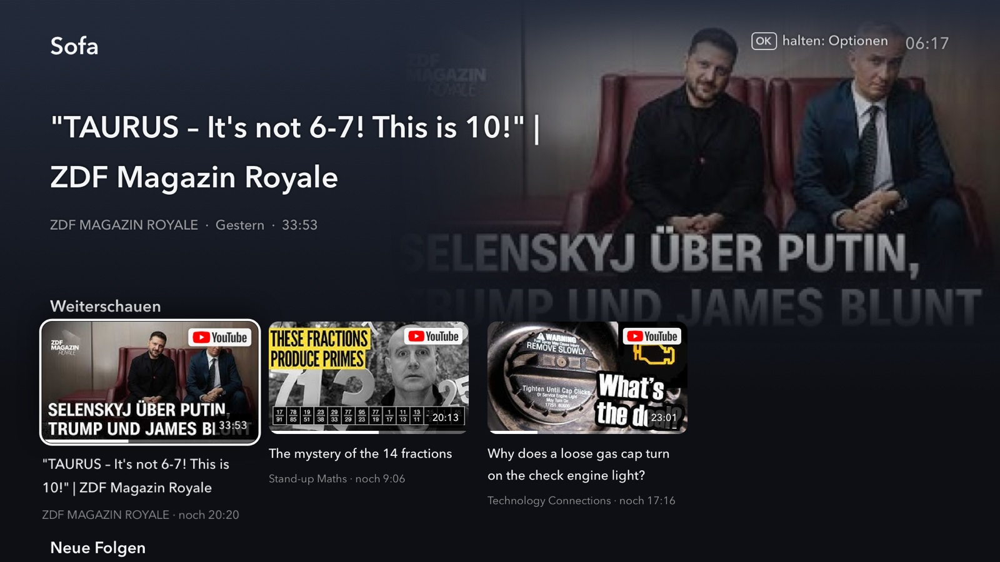
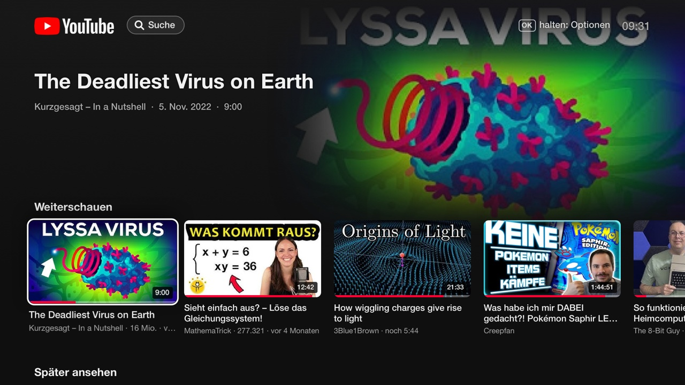
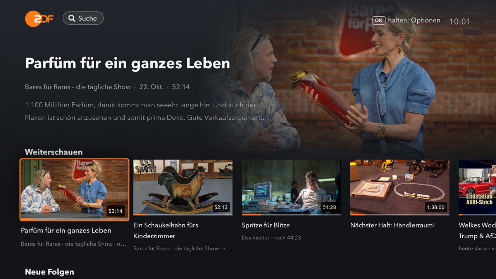
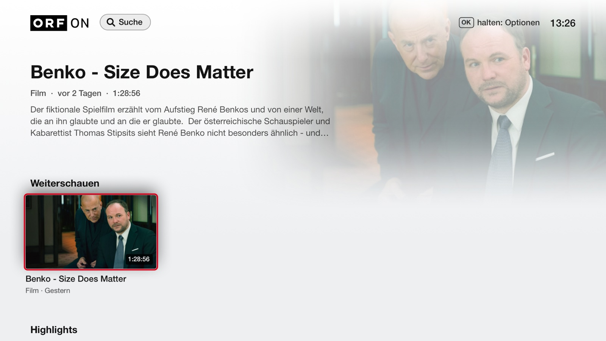
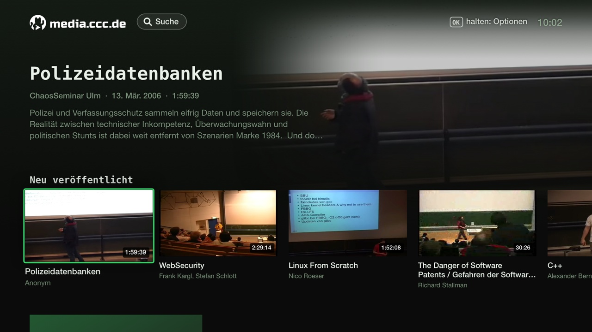
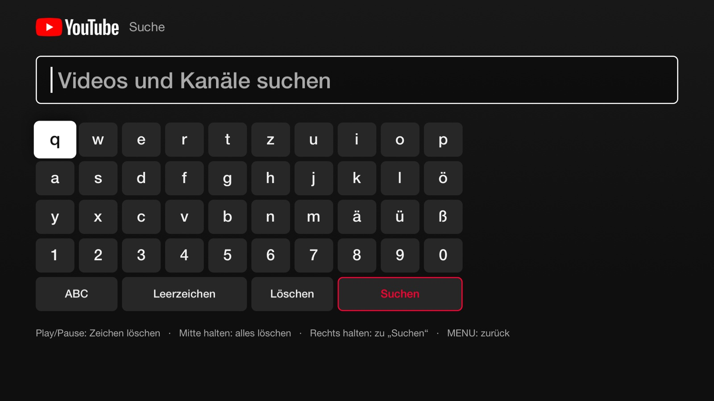

# Sofa

**Turn an old iMac into a web TV.**

Lots of 2009–2012 iMacs still have a beautiful big screen, decent speakers and an
Apple Remote, but they're stuck on an OS that today's streaming apps and browsers
no longer support. Sofa is a native smart-TV app for these Macs. From the couch, with
the 7-button Apple Remote, you watch YouTube and the public German/Austrian
broadcasters' Mediatheken. It runs on **OS X 10.9 Mavericks** as a native app, with no
browser and no Electron.



| | |
|---|---|
|  |  |
|  |  |
|  | Everything is operated with the 7-button Apple Remote: arrows, OK, MENU and Play/Pause. Holding OK opens options; holding MENU goes home. |

- **Sources:** YouTube (channels, playlists, search, live streams; no account needed),
  ZDF, ARD, ORF and media.ccc.de, each with its own look.
- **Follow shows and channels:** new episodes from everything you follow, a shared
  "Watch later" list across all sources, Continue watching and History.
- **Downloads as a feature, not a chore:** episodes of followed shows can be fetched
  automatically for instant start and offline viewing, and watched ones are cleaned up.
- **Phone pairing:** "Link with TV code" from the YouTube app on your phone casts to Sofa.
- **Remote-first UX:** everything works with Up/Down/Left/Right, OK, MENU and
  Play/Pause. Long press opens options, and there is an on-screen keyboard with live
  suggestions for search. No mouse or keyboard ever needed.
- **Modern codecs on an old Mac:** H.264 plays hardware-decoded through AVFoundation.
  VP9/AV1/Opus goes through libmpv (1080p60 on a 2011 i5). A local proxy and libcurl
  bridge the TLS 1.3 / HLS gaps of 10.9.
- **Live updates:** a new build is swapped in even during playback, and the position is kept.

The UI is in German (the target audience is the German-speaking broadcasters' viewers).

## Why it exists

An old iMac makes a perfect kitchen or living-room TV, if something modern runs
on it. Sofa is that something. It's the main use case behind
**[mac-backport/backport-toolkit](https://github.com/mac-backport/backport-toolkit)**,
which brings a modern compiler, libcurl/OpenSSL, mpv and Python back to OS X 10.9 via MacPorts.

## Requirements

- An Intel Mac on OS X 10.9.5 (developed on an iMac12,2).
- [MacPorts](https://www.macports.org) with the
  [backport-toolkit](https://github.com/mac-backport/backport-toolkit) overlay.
- An Apple Remote (IR) is recommended; the `SofaRemote` helper takes over the IR receiver.

## Install

```sh
sudo port -n install sofa   # Sofa.app + all dependencies (mpv, ffmpeg, curl, python, node, PO token service)
sudo port load sofa         # Apple Remote helper + start Sofa at login (run in Terminal on the Mac)
```

The local YouTube PO token service (`bgutil-pot-server`, 127.0.0.1 only) starts automatically.
On first start Sofa explains the remote; on first use of YouTube it sets up its own yt-dlp environment
(`~/Library/Application Support/Sofa/ytdlp`, about a minute) and keeps it updated daily.

## Build from source

```sh
make            # build/Sofa.app (+ SofaRemote helper, + SofaDev.app for testing)
make install    # copies Sofa.app to /Applications (PREFIX=..., DESTDIR=... supported)
```

Development uses an isolated dev instance (`tools/sofa-dev`) with its own data, plus a
browser-based viewer/remote. See [`NOTES.md`](NOTES.md) (German) for architecture,
decisions and the source APIs ([`docs/`](docs/): YouTube InnerTube & Lounge, Mediathek APIs, codecs).

## License

Sofa is free software under the [GNU General Public License v3.0](LICENSE)
(it links libmpv, which MacPorts builds under the GPL).

## Disclaimer

A personal, non-commercial project. Not affiliated with YouTube/Google, ZDF, ARD, ORF
or the CCC. Logos belong to their owners. Content is streamed from the official public
endpoints; geo- and DRM-restrictions are respected and shown, not bypassed.
